# Designing and executing tools

The tool designer saves a function name, a description shown to Granite, an argument schema, and your Python source. You write the implementation. No datetime or file-search function is built into the Python executor.

Choose **Tool library → New tool**, fill in the name and description, edit the JSON parameter schema and write `execute(arguments)`. Save the definition, then open a draft study's **Tools → Add from library**. You can also create a tool directly inside a study. Attaching a library tool makes a copy; changing or removing the library entry leaves existing copies and run snapshots intact.

## What happens in B1

```mermaid
flowchart LR
    Audio[Recorded question] --> Whisper[Whisper transcript]
    Whisper --> Route[Granite selects function]
    Route --> Arguments[Granite generates JSON arguments]
    Arguments --> Validate[Validate schema and grounding]
    Validate --> Execute[Execute saved Python function]
    Execute --> Facts[Return facts and sources]
    Facts --> MiniCPM[Inject facts into MiniCPM]
    MiniCPM --> Output[Receive generated speech]
```



Granite does not write or run Python. First it scores routing choices: A means no tool, B means clarification needed, and C onward map to attached functions. Routing now records the label-to-function mapping, descriptions, required arguments and scores. These scores are model likelihoods, not calibrated confidence probabilities. After selecting a function, Granite generates its native `<tool_call>` response containing a name and arguments. The runtime checks that the selected function is attached to the study and validates those arguments before executing the saved code.

A tool with no required arguments can be called with `{}`. Optional arguments are omitted when the user did not supply them; your Python code handles its own defaults. When argument grounding is enabled, string values must appear in the committed transcript. Turn it off for functions that accept normalized identifiers or other values that do not literally match speech. The calculator retains its spoken-arithmetic normalization.

The router supports at most 20 attached tools. B0 does not execute tools; B2 injects the case's saved oracle fact through the same native adapter. A no-call, clarification, invalid call or failed tool continues without tool context. A native evaluation acknowledgement confirms that context was evaluated; listening to the recording determines spoken correctness.

## Python contract

Define a synchronous top-level function:

```python
def execute(arguments):
    # Implement your function using the validated arguments.
    facts = ...
    return {"facts": facts, "sources": []}
```

The function may return non-empty text instead of a dictionary. With a dictionary, `facts` must be non-empty text and `sources` must be a list of strings. Results allow up to 32,000 fact characters and 100 sources. `print()` output and exceptions appear in the operation's runtime logs.

Each call runs in a separate Python process on the runtime server, using that server's packages and account access. Imports, files and network connections are available according to that environment. Only code that you authored and saved is executed. The timeout defaults to 10 seconds and can be set up to 120 seconds. Runtime shutdown and worker timeouts also stop owned tool processes. This process boundary provides cancellation and separation from model inference; it is not a security sandbox.

The parameter editor accepts a JSON Schema subset: object, array, string, integer, number, boolean and null types; properties, required, additionalProperties, items, enum, const, defaults, descriptions, bounds, lengths and patterns. Unsupported keywords are rejected. Defaults are schema annotations and are not automatically inserted. Each node needs a type. The root must be an object. Use empty `properties` and `required` for zero-argument functions. Arguments are limited to 16 KiB and 12 schema nesting levels.

## Existing document search

The existing **document** implementation searches the `records` dictionary entered in its JSON editor. It uses the reference project's `DocumentSearch` implementation and returns those fixture facts. It does not read PDFs or files from disk.

For actual file search, choose **Python**, declare the search arguments, and write a function that reads your documents on the runtime server. Configure paths in your source and install any parser package you use in the runtime virtual environment. The study backend never reads those external documents or executes the function. The returned facts, sources, exact source code and argument/result evidence are saved with the run.

## Inspect evidence

Open **Operations** for queue positions, operation payloads, start/finish times and progress. Select **Inspect** to view persistent platform logs, the remote job and worker/Python output. Active work refreshes automatically. Complete operations use locally collected logs, so they remain available when the runtime is offline. The run inspector provides the inference timeline, caller action, tool result, injected context and native acknowledgements.

Python execution artifacts include the exact source/arguments request, its SHA-256 source hash, the result, a log, status and elapsed milliseconds. The inference trace includes argument validation, normalization, configured delay, execution and subprocess spans. Platform progress logs are separate from measured inference telemetry.

## Export and deletion

**Export ZIP** is available at the top of a study. It bundles study/settings/tool metadata, source files, frozen snapshots, per-run metadata, analysis/CSV, stored audio, runtime evidence, transcription artifacts and operation records/logs. Historical input recordings are collected from run snapshots even after a draft case has changed.

`manifest.json` lists each archived file's size and SHA-256 checksum, pending runs and missing artifacts. It excludes its own hash. Model weights, external documents read by Python, credentials and unrelated library templates are not copied into the archive. Incomplete or old runs may not have every artifact; the manifest records that limitation. New native runs also preserve the actual reference voice WAV used for initialization.

**Delete study** moves it to Trash and retains its files. **Show Trash → Restore** on the dashboard restores it. Finish the study's queued/running work before deleting it. Shared recordings used by cloned studies remain available.
