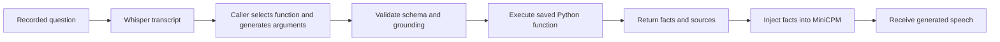

# Designing and executing tools

The tool designer saves a function name, a description shown to the selected caller, an argument schema, and your Python source. You can write the implementation or start with an editable template. The Python executor uses the same contract for every function.

Choose **Tool library → New tool**, fill in the name and description, edit the JSON parameter schema and write `execute(arguments)`. Save the definition, then open a draft study's **Tools → Add from library**. You can also create a tool directly inside a study. Attaching a library tool makes a copy; changing or removing the library entry leaves existing copies and run snapshots intact.

## Server clock and current-information search

New studies include `room_lookup`, `document_search`, `server_datetime` and
`web_search`. Calculator is no longer a starter tool or starter case category.
Existing studies keep their original definitions and calculator execution remains
supported. To change an old study, clone it if frozen, remove its calculator and
use **Tools → Add from library / templates** to attach the new tools. The same
templates are available in **Tool library** and their Python source is editable.

`server_datetime` takes no arguments. Its Python function reads the pipeline
server's clock and returns both server-local and UTC date/time, with the timezone.
It does not infer the user's timezone. The saved evidence contains the exact
instant used to produce the response. For a **datetime** case, select the
**Live server clock** B2 reference source: B2 reads a fresh clock after the configured
oracle delay and uses the ordinary injection channel. It bypasses Whisper and the
caller, as B2 should. B0 and B1 never receive this reference mode or its value.
Review the spoken time against that run's evidence, allowing for spoken precision
and elapsed time; different runs will legitimately have different clock values.

`web_search` takes a `query` string and performs one Exa Search request with up to
three results and highlights. It returns excerpts, not an AI-generated answer.
Two short excerpts fit inside the native context limit; full returned excerpts,
titles, source URLs, available publication dates, retrieval times, request ID and
provider cost metadata remain in the tool result's `evidence`. MiniCPM generates
the spoken answer. Missing credentials, exhausted credits and empty results are
recorded as tool failures, with no invented answer or fallback search provider.
See [server configuration](../installation/README.md#enable-web-search).

Exa also writes timestamped JSON entries to the existing per-tool `.log` artifact:
query and request body, HTTP status, complete parsed successful response,
request/total elapsed milliseconds, the shortened facts returned for injection,
and failures. Authentication headers and API keys are excluded. Open **Run → Tool
path → tool.python_finished → Download tool log** to keep the full file. Study
ZIP exports include it, and Atlas-backed installations preserve it with the other
collected run artifacts. A killed or timed-out process may leave only the initial
entries; the execution record separately records the timeout. Timing and logs for
past runs cannot be reconstructed retroactively.

The starter web questions cover politics, software releases, science awards,
sport, film and economics. All 48 starter cases leave **Expected spoken answer**
blank for manual review. Independently verify spoken correctness against an
authoritative source and record its URL and verification date. The **B2 oracle
fact** is separate from this review field: enter that verified reference before
freezing web cases. Search results may be stale or contradictory,
and their retrieval time is not proof of freshness. Recheck references before a
new evaluation batch. Live results can differ between caller runs; use an
additional frozen-fixture comparison when you need identical returned evidence.
Keep B0: a model may already know a current officeholder, so that example alone
does not prove that external information caused a correct answer.

## What happens in B1



The selected caller (Granite or Qwen3 with thinking disabled) receives the committed transcript and all attached function schemas in one generation. It returns one native `<tool_call>` containing a name and arguments, or a plain response/clarification. It does not write or run Python. The runtime checks that the function is attached to the study and validates its arguments before executing the saved code. Raw output and prompt metadata are retained; there is no separate letter classifier or argument-generation pass.

A tool with no required arguments can be called with `{}`. Optional arguments are omitted when the user did not supply them; your Python code handles its own defaults. When argument grounding is enabled, string values must appear in the committed transcript. Turn it off for functions that accept normalized identifiers or other values that do not literally match speech. The calculator retains its spoken-arithmetic normalization.

The router supports at most 20 attached tools. B0 does not execute tools; B2 injects the case's saved oracle fact (or its explicit server-clock reference) through the same native adapter. Plain responses and clarification questions are delivered as response guidance. Invalid calls and failed tools retain the diagnostic error and deliver retry guidance; they do not populate tool facts. A native evaluation acknowledgement confirms that context was evaluated; listening to the recording determines spoken correctness.

## Python contract

Define a synchronous top-level function:

```python
def execute(arguments):
    # Implement your function using the validated arguments.
    facts = ...
    return {"facts": facts, "sources": []}
```

The function may return non-empty text instead of a dictionary. With a dictionary, `facts` must be non-empty text and `sources` must be a list of strings. An optional `evidence` JSON object is preserved for inspection and export but is not injected into MiniCPM. Results allow up to 32,000 fact characters, 100 sources and 1 MiB of serialized output. The native context has a smaller byte limit, so return concise facts and keep full supporting material in evidence. `print()` output and exceptions appear in the operation's runtime logs.

Each call runs in a separate Python process on the runtime server, using that server's packages and account access. Imports, files and network connections are available according to that environment. Only code that you authored and saved is executed. The timeout defaults to 10 seconds and can be set up to 120 seconds. Runtime shutdown and worker timeouts also stop owned tool processes. This process boundary provides cancellation and separation from model inference; it is not a security sandbox.

The parameter editor accepts a JSON Schema subset: object, array, string, integer, number, boolean and null types; properties, required, additionalProperties, items, enum, const, defaults, descriptions, bounds, lengths and patterns. Unsupported keywords are rejected. Defaults are schema annotations and are not automatically inserted. Each node needs a type. The root must be an object. Use empty `properties` and `required` for zero-argument functions. Arguments are limited to 16 KiB and 12 schema nesting levels.

## Locate a file by name

The default `document_search` tool is a Python filename locator. It searches an
explicit virtual file index and returns matching folders/full paths. It does not
need actual files on the GPU server and does not answer questions about document
contents. Its schema requires `filename`, for example:

```json
{"name": "document_search", "arguments": {"filename": "project-report.pdf"}}
```

The tool designer's Python source contains an editable list:

```python
from tool_pipeline.file_index import FileIndex

FILES = [
    "/projects/orion/finance/budget.xlsx",
    "/archive/team-notes/meeting-notes.txt",
    "/research/drafts/project-report.pdf",
]

def execute(arguments):
    return FileIndex(FILES).search(arguments["filename"])
```

This index is saved with the tool definition in the study database, frozen
snapshots and run source artifacts. It can also be loaded from your own JSON/text
index by editing the Python source; filesystem scanning is not required. The
caller sees the filename schema and description; the indexed folder answers are
not included in that schema. The pipeline executes the configured function.

For “Which folder is project-report.pdf in?”, the sample tool returns:

```text
Found 1 exact filename match. File project-report.pdf is in folder /research/drafts. Full path: /research/drafts/project-report.pdf.
```

Matching ignores case, punctuation and spacing, including spoken “dot PDF”. It
returns one of three outcomes, stated in the facts delivered to MiniCPM and saved
as `evidence.match_type`:

- `exact`: the complete normalized filename matches. Exact matches take priority
  over all approximate candidates. Duplicate filenames return every distinct location.
- `approximate`: no exact match exists, but filenames meet the similarity threshold.
  For example, `bugdet.xlsx` can retrieve `budget.xlsx`. Results are explicitly
  described as possible matches and ordered by descending similarity, then path
  for ties. Multiple candidates are returned rather than silently choosing one.
- `not_found`: no filename is sufficiently similar. The tool returns “No file found
  with the name …” as a normal result, so MiniCPM receives that information rather
  than generic tool-failure guidance. Invalid arguments and Python failures remain errors.

The fallback uses Python's standard-library `difflib.SequenceMatcher` with
`autojunk=False`, on normalized filenames. Its default threshold is **0.8**. If
the request omits an extension, it also compares the filename stem and takes the
higher score; a stem-only match is still approximate, even if its score is 1.0.
A supplied but different extension may qualify as approximate, never exact. Broad
partial names can still produce no result; for example, `report` does not meet the
default threshold for `project-report.pdf`.

To tune the threshold, change the saved tool source to
`FileIndex(FILES, similarity_threshold=0.9).search(arguments["filename"])`.
The score measures string similarity, not the probability that this is the file
the user intended. Validate a chosen threshold on development questions before
collecting evaluation results.

Evidence retains the requested name, normalized key, match type, all returned
paths and their scores, threshold, method, and implementation version
`filename-index-v2`. String grounding remains disabled for this template so a
filename can differ from the literal Whisper transcript. The matcher runs in
the independent pipeline and needs no model or additional package.

Existing Python definitions that call `FileIndex(FILES).search(...)` use this
matching behavior after the GPU runtime is updated and restarted; previously
saved results are unchanged. The revised caller-facing description is included
in newly attached templates. Existing tools keep their saved descriptions; edit
them in a draft if needed. Record this change when comparing older and newer runs.

The 12 default document questions now use three indexed filenames and four
conversational phrasings, such as “Where did I save budget.xlsx?” and “I can't find
meeting-notes.txt. Where is it?”. Their B2 facts contain the configured locations;
Expected spoken answer remains blank for human review. If you edit the index,
update the corresponding B2 references before freezing.

Existing studies keep their saved tool and questions. In a draft, remove the old
`document_search` definition and add the current version through **Tools → Add
from library / templates**. Replace its old policy-content questions or load the
revised template in a new empty study. Frozen studies require cloning first.
Previously recorded audio is not rewritten. The legacy **document** implementation
remains available for old record-based content fixtures.

## Inspect evidence

Open **Operations** for queue positions, operation payloads, start/finish times and progress. Select **Inspect** to view persistent platform logs, the remote job and worker/Python output. Active work refreshes automatically. Complete operations use locally collected logs, so they remain available when the runtime is offline. The run inspector provides the inference timeline, caller action, tool result, injected context and native acknowledgements.

Python execution artifacts include the exact source/arguments request, its SHA-256 source hash, the result, a log, status and elapsed milliseconds. The inference trace includes argument validation, normalization, configured delay, execution and subprocess spans. Platform progress logs are separate from measured inference telemetry.

## Export and deletion

**Export ZIP** is available at the top of a study. It bundles study/settings/tool metadata, source files, frozen snapshots, per-run metadata, analysis/CSV, stored audio, runtime evidence, transcription artifacts and operation records/logs. Historical input recordings are collected from run snapshots even after a draft case has changed.

`manifest.json` lists each archived file's size and SHA-256 checksum, pending runs and missing artifacts. It excludes its own hash. Model weights, external documents read by Python, credentials and unrelated library templates are not copied into the archive. Incomplete or old runs may not have every artifact; the manifest records that limitation. New native runs also preserve the actual reference voice WAV used for initialization.

**Delete study** permanently removes the study, run metadata, reviews, recordings, traces, Exa/tool logs and operation records from managed storage. Finish queued/running work first. Shared recordings used by another study or clone remain until their last reference is removed. Interrupted cleanup is retryable from **Show Trash → Delete permanently**; it cannot be restored once permanent cleanup starts. Older trashed studies can also be deleted permanently there.
