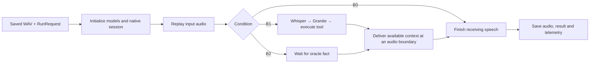

# Tool Pipeline

An independently installable audio-in/audio-out inference package. It has no dependency on the study backend, SQLite, the frontend or study services. Use it through the `speech-runtime` HTTP service, `speech-infer` CLI, or `InferencePipeline` Python class.

The study application submits audio and configuration once. This package owns replay, Whisper, Granite, tool validation/execution, context injection, native acknowledgements, output audio and telemetry. Kokoro synthesis and output transcription are separate jobs outside inference timing.

A reference-audio error refers to the configuration saved in that run. The worker reports whether `reference_audio` is empty or its file is missing, including the checked path and runtime hostname for missing files. Inspect the failed run's **Request & provenance** settings; changing the study's settings affects newly created runs. The WAV must be accessible to the pipeline worker's host.

## Installation and device configuration

Follow the [setup guide](../installation/README.md) for installation, updates, generated
launch scripts, and native-stack startup. Use `--runtime-only` on the bootstrap
when deploying the pipeline without the study website. The model environment is
independent of the image's preinstalled PyTorch environment.

The generated `run-settings.json` selects GPU 0 on a single-GPU server. Use those
settings rather than assuming a second GPU exists. A configured reference WAV
must be accessible on the pipeline server.

Set `tts_device: "cuda:0"` in the study settings to generate question audio with Kokoro on GPU 0. Supported values are `cpu`, `cuda` (the current CUDA device), and `cuda:<index>`. Existing settings without this field keep CPU synthesis; the GPU installer generates an explicit CUDA setting. A requested unavailable GPU fails the job instead of silently using CPU. Model execution uses float32; text processing, resampling and file storage remain on CPU. Preparation traces include device setup, synchronized model loading and synthesis, and the actual device is saved in audio provenance. GPU synthesis has a separate cache identity; previously attached recordings remain unchanged.

## Native MiniCPM stack

The installer builds the patched native server and prepares the official Demo's
remote backend worker and gateway. Source revisions are declared in
[native launcher](../installation/internal/launch_native.py); the build and patch provenance are recorded
in `setup-manifest.json`. The complete model snapshot must retain its companion
`audio/`, `vision/`, `tts/`, and `token2wav-gguf/` directories. Use the generated
native launcher described in the [setup guide](../installation/README.md).

## HTTP service

```bash
export SPEECH_RUNTIME_TOKEN='your-shared-token'
speech-runtime --host 127.0.0.1 --port 8766 --data ./data/runtime
# Equivalent: python -m tool_pipeline --port 8766
```

Endpoints:

| Endpoint | Purpose |
| --- | --- |
| `GET /health` | Dependency presence and active jobs |
| `POST /jobs` | Submit one inference, synthesis or transcription job |
| `GET /jobs/{id}` | Status, result and artifact names |
| `GET /jobs/{id}/telemetry` | Current inference/preparation/analysis trace |
| `GET /jobs/{id}/artifacts/{name}` | Download an artifact |

If configured, send `Authorization: Bearer <token>`. Jobs persist to disk and run serially in subprocesses. Each subprocess executes `tool_pipeline.service.worker`; neither the service nor the worker imports the study backend. Health reports dependency presence, not that weights or native/CUDA placement are ready.

## CLI and Python interface

```bash
speech-infer --request request.json --output ./standalone-run
# Equivalent: python -m tool_pipeline.cli --request request.json --output ./standalone-run
```

Minimal B0 request:

```json
{
  "condition": "B0",
  "audio_path": "/srv/inputs/question.wav",
  "settings": {
    "native_url": "ws://127.0.0.1:8000/v1/realtime?mode=audio",
    "reference_audio": "/srv/MiniCPM-o-Demo/assets/ref_audio/ref_en_dlc_1.wav"
  }
}
```

For HTTP submission replace `audio_path` with the WAV's `audio_base64` and set `job_kind` to `inference`. The service validates the optional `audio_sha256`, writes the input and provides its local path to the worker.

```python
import asyncio
from pathlib import Path
from speech_contracts import RunRequest
from tool_pipeline.pipeline import InferencePipeline

request = RunRequest.from_dict(payload)
result = asyncio.run(InferencePipeline(request, Path("standalone-run")).run())
```

B1 receives `tools` definitions and no oracle/expected answer. Each tool has `name`, `description`, required string `parameter`, `kind`, `records`, optional `aliases`, `delay_ms` and `failure`. B2 receives `oracle_result`; use null for no-tool cases. All conditions use native MiniCPM speech output.

## Implementation

Start with [pipeline/runner.py](src/tool_pipeline/pipeline/runner.py). There is one coordinator, `InferencePipeline`, whose `run()` method runs inference, finalizes the session and saves the result. The other pipeline modules contain ordinary helper functions; they do not introduce controller or strategy classes.

```text
src/tool_pipeline/
  pipeline/
    runner.py        initialize → replay → resolve context → finish → save
    context.py       B1: Whisper + Granite + tool; B2: delayed oracle fact
    playback.py      paced audio replay and bounded silence/injection
    results.py       RunState dataclass and result/trace file output
  models/
    granite.py       tool selection and argument generation
    whisper.py       audio transcription
    minicpm.py       native session, speech reception and injection ACKs
    preparation.py   Kokoro input synthesis and output transcription jobs
  service/
    api.py           optional FastAPI HTTP wrapper
    jobs.py          saved job status and serial worker processes
    worker.py        dispatch one inference, synthesis or transcription job
    storage.py       job files
  tools.py           validate arguments and dispatch fixtures or Python tools
  python_tool.py     supervise authored function processes and record execution
  python_worker.py   execute saved source with JSON arguments, capture output
  telemetry.py       nested timings, events and memory sampling
  audio.py           WAV/PCM conversion
  reference.py       access the installed minicpm_tool reference
  provenance.py      software/environment metadata
  cli.py             run directly from a saved request
```

The execution flow is:



No-call, clarification, invalid-call and failed-tool paths continue without context. B2 also sends no context when its oracle is absent. MiniCPM output is received concurrently throughout replay and context resolution. `RunState` holds the transcript, action, tool result and timestamps collected during one run. The JSON result format is unchanged.

For the shortest reading path: `pipeline/runner.py` → `pipeline/context.py` → `pipeline/playback.py`. Read `models/` for model details and `service/` only when working on HTTP/job management. Direct Python and CLI execution do not call the HTTP service.

The [update procedure](../installation/README.md#update-an-existing-installation) refreshes editable packages and console entry points. `from tool_pipeline.pipeline import InferencePipeline`, `speech-infer`, `speech-runtime` and the HTTP endpoints keep the same public usage.

Only `speech_contracts` is shared with the study application. `duplex_tools` is the reference dependency for Granite parsing and deterministic fixture implementations. Model packages are imported lazily by workers.

## Timing and verification

Full-recording ASR is committed after non-live input replay ends. Paced replay is the default. Final silence is unit-bounded and resets after injection; unpaced timings must be analyzed separately. Initialization, inference and output ASR use distinct traces.

The pipeline records monotonic nanoseconds, nested step/substep spans, actual events, exact injected payloads and acknowledgements, process RSS/NVML samples, supported Granite CUDA timing, and provenance. Native process memory and internal encoding/prefill/decode/vocoding remain explicitly unavailable without native instrumentation. Sampled memory is not an exact transient peak. An ACK does not prove a correct audible answer.

```bash
python -m pytest tests -q
python -m compileall -q src ../installation/internal
```

CPU protocol and timing checks pass. The real TCP fixture is skipped only when the sandbox blocks listening sockets. Actual MiniCPM/Granite/Whisper/Kokoro execution and GPU timing require remote validation; no synthetic test fixture is presented as a study result.

## Authored Python tools

`kind: "python"` tools carry a `parameters` object schema and `python_code` defining `execute(arguments)`. The pipeline validates arguments, runs the saved source in a separate process, applies `timeout_seconds`, and records request/source/result/log files. Code runs with the runtime account's access and packages. The study backend submits definitions and collects artifacts; it does not execute them. See [the tool designer guide](../docs/TOOL_DESIGNER.md) for details. The runtime adds `GET /jobs/{id}/logs` for bounded live log tails.
