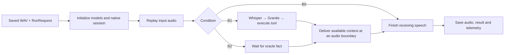

# Tool Pipeline

An independently installable audio-in/audio-out inference package. It has no dependency on the study backend, SQLite, the frontend or study services. Use it through the `speech-runtime` HTTP service, `speech-infer` CLI, or `InferencePipeline` Python class.

The study application submits audio and configuration once. This package owns replay, Whisper, Granite, tool validation/execution, context injection, native acknowledgements, output audio and telemetry. Kokoro synthesis and output transcription are separate jobs outside inference timing.

## Installation on the GPU server

For Linux NVIDIA servers with CUDA 12.5, use the [setup script and launch guide](CUDA125_SETUP.md):

```bash
bash tool_pipeline/setup_cuda125.sh --install-system-deps
# Add --with-platform to install the website in a separate environment too.
```

Run this from the copied project parent directory. It checks the existing driver/toolkit, installs constrained model dependencies, builds the patched native runtime, downloads pinned model snapshots and generates launch scripts and run settings. No GPU execution has been verified on this development machine.

Clone `minicpm_study` and the reference `minicpm_tool` as adjacent repositories. This package and `speech_contracts` live inside `minicpm_study`; the reference lives one level above them. Use Python 3.11 or 3.12 and the server's CUDA-compatible Torch build.

```bash
cd tool_pipeline
python3.11 -m venv .venv
source .venv/bin/activate
python -m pip install -e ../speech_contracts
python -m pip install -e '.[models,dev]'
python -m pip install -e ../../minicpm_tool
```

Install `espeak-ng` for Kokoro English synthesis. Granite and Whisper default to GPU 1. For a one-GPU server use `granite_device: "cuda:0"` and `whisper_device_index: 0`, with enough remaining memory beside MiniCPM. Plain `pip install -e .` installs only service/transport dependencies; `.[models]` installs model dependencies.

## Native MiniCPM stack

Prepare the reference's pinned [live duplex setup](https://github.com/smfabrar/minicpm_tool/blob/f3e7cdc08cdf49c50414f405f31fc0eee9bca105/docs/live_duplex_protocol.md) and [setup notebook](https://github.com/smfabrar/minicpm_tool/blob/f3e7cdc08cdf49c50414f405f31fc0eee9bca105/notebooks/kaggle_live_duplex.ipynb), or build the same sources manually:

- Native `tc-mb/llama.cpp-omni` revision `873056743b74e1a4ce5dcf7290e2298428e214db`.
- Gateway/worker `OpenBMB/MiniCPM-o-Demo` revision `47709a9210dfd71afa76c058e017fc8c4db5c8d2`.
- Apply `minicpm_tool/fixtures/realtime-tool-context.patch` to the native checkout.
- Build `llama-omni-server` with CUDA, `GGML_CUDA_NO_VMM=ON`, `LLAMA_OPENSSL=OFF`, and your GPU architecture. The reference uses architecture 75 for T4. Install the official Demo's gateway/worker dependencies separately.
- Download the complete `openbmb/MiniCPM-o-4_5-gguf` module layout: main Q4_K_M model plus vision, audio, TTS, projector and token2wav modules listed in the notebook.

Start the prepared stack:

```bash
python launch_native.py \
  --upstream /srv/llama.cpp-omni \
  --demo /srv/MiniCPM-o-Demo \
  --model /srv/models/MiniCPM-o-4_5-gguf/MiniCPM-o-4_5-Q4_K_M.gguf \
  --patch /srv/projects/minicpm_tool/fixtures/realtime-tool-context.patch \
  --logs /srv/native-runs/session-01
```

Use a fresh log directory. The launcher verifies source revisions and the applied patch, starts the backend/gateway/worker, registers the worker and writes a manifest. It checks sources, not that an existing binary was rebuilt from them: build after patching and retain build evidence. Put its printed `native_url`, `reference_audio` and `patch_sha256` into your request settings. Paths refer to this server.

## HTTP service

```bash
export SPEECH_RUNTIME_TOKEN='your-shared-token'
speech-runtime --host 127.0.0.1 --port 8766 --data ./data/runtime
# Equivalent: python -m tool_pipeline --port 8766
```

Endpoints:

| Endpoint | Purpose |
| --- | --- |
| `GET /health` | Dependency presence and active jobs |
| `POST /jobs` | Submit one inference, synthesis or transcription job |
| `GET /jobs/{id}` | Status, result and artifact names |
| `GET /jobs/{id}/telemetry` | Current inference/preparation/analysis trace |
| `GET /jobs/{id}/artifacts/{name}` | Download an artifact |

If configured, send `Authorization: Bearer <token>`. Jobs persist to disk and run serially in subprocesses. Each subprocess executes `tool_pipeline.service.worker`; neither the service nor the worker imports the study backend. Health reports dependency presence, not that weights or native/CUDA placement are ready.

## CLI and Python interface

```bash
speech-infer --request request.json --output ./standalone-run
# Equivalent: python -m tool_pipeline.cli --request request.json --output ./standalone-run
```

Minimal B0 request:

```json
{
  "condition": "B0",
  "audio_path": "/srv/inputs/question.wav",
  "settings": {
    "native_url": "ws://127.0.0.1:8000/v1/realtime?mode=audio",
    "reference_audio": "/srv/MiniCPM-o-Demo/assets/ref_audio/ref_en_dlc_1.wav"
  }
}
```

For HTTP submission replace `audio_path` with the WAV's `audio_base64` and set `job_kind` to `inference`. The service validates the optional `audio_sha256`, writes the input and provides its local path to the worker.

```python
import asyncio
from pathlib import Path
from speech_contracts import RunRequest
from tool_pipeline.pipeline import InferencePipeline

request = RunRequest.from_dict(payload)
result = asyncio.run(InferencePipeline(request, Path("standalone-run")).run())
```

B1 receives `tools` definitions and no oracle/expected answer. Each tool has `name`, `description`, required string `parameter`, `kind`, `records`, optional `aliases`, `delay_ms` and `failure`. B2 receives `oracle_result`; use null for no-tool cases. All conditions use native MiniCPM speech output.

## Implementation

Start with [pipeline/runner.py](src/tool_pipeline/pipeline/runner.py). There is one coordinator, `InferencePipeline`, whose `run()` method runs inference, finalizes the session and saves the result. The other pipeline modules contain ordinary helper functions; they do not introduce controller or strategy classes.

```text
src/tool_pipeline/
  pipeline/
    runner.py        initialize → replay → resolve context → finish → save
    context.py       B1: Whisper + Granite + tool; B2: delayed oracle fact
    playback.py      paced audio replay and bounded silence/injection
    results.py       RunState dataclass and result/trace file output
  models/
    granite.py       tool selection and argument generation
    whisper.py       audio transcription
    minicpm.py       native session, speech reception and injection ACKs
    preparation.py   Kokoro input synthesis and output transcription jobs
  service/
    api.py           optional FastAPI HTTP wrapper
    jobs.py          saved job status and serial worker processes
    worker.py        dispatch one inference, synthesis or transcription job
    storage.py       job files
  tools.py           validate and execute deterministic tools
  telemetry.py       nested timings, events and memory sampling
  audio.py           WAV/PCM conversion
  reference.py       access the installed minicpm_tool reference
  provenance.py      software/environment metadata
  cli.py             run directly from a saved request
```

The execution flow is:



No-call, clarification, invalid-call and failed-tool paths continue without context. B2 also sends no context when its oracle is absent. MiniCPM output is received concurrently throughout replay and context resolution. `RunState` holds the transcript, action, tool result and timestamps collected during one run. The JSON result format is unchanged.

For the shortest reading path: `pipeline/runner.py` → `pipeline/context.py` → `pipeline/playback.py`. Read `models/` for model details and `service/` only when working on HTTP/job management. Direct Python and CLI execution do not call the HTTP service.

After updating an existing installation to this layout, refresh the console entry points using that environment's Python: `python -m pip install --no-deps -e /path/to/tool_pipeline`. The setup script also does this. `from tool_pipeline.pipeline import InferencePipeline`, `speech-infer`, `speech-runtime` and the HTTP endpoints keep the same public usage.

Only `speech_contracts` is shared with the study application. `duplex_tools` is the reference dependency for Granite parsing, argument validation and deterministic tool implementations. Model packages are imported lazily by workers.

## Timing and verification

Full-recording ASR is committed after non-live input replay ends. Paced replay is the default. Final silence is unit-bounded and resets after injection; unpaced timings must be analyzed separately. Initialization, inference and output ASR use distinct traces.

The pipeline records monotonic nanoseconds, nested step/substep spans, actual events, exact injected payloads and acknowledgements, process RSS/NVML samples, supported Granite CUDA timing, and provenance. Native process memory and internal encoding/prefill/decode/vocoding remain explicitly unavailable without native instrumentation. Sampled memory is not an exact transient peak. An ACK does not prove a correct audible answer.

```bash
python -m pytest tests -q
python -m compileall -q src launch_native.py
```

CPU protocol and timing checks pass. The real TCP fixture is skipped only when the sandbox blocks listening sockets. Actual MiniCPM/Granite/Whisper/Kokoro execution and GPU timing require remote validation; no synthetic test fixture is presented as a study result.
